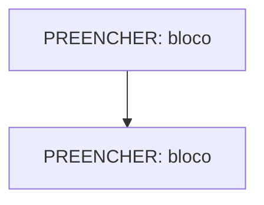

# Diagrama de arquitetura

Mostrem os blocos do sistema e como eles dependem uns dos outros. O GitHub renderiza diagramas [Mermaid](https://mermaid.js.org/); imagens também são aceitas.

**Relação com os ADRs:** <PREENCHER: qual ADR justifica esta organização>

**O que este diagrama não mostra:** <PREENCHER>
